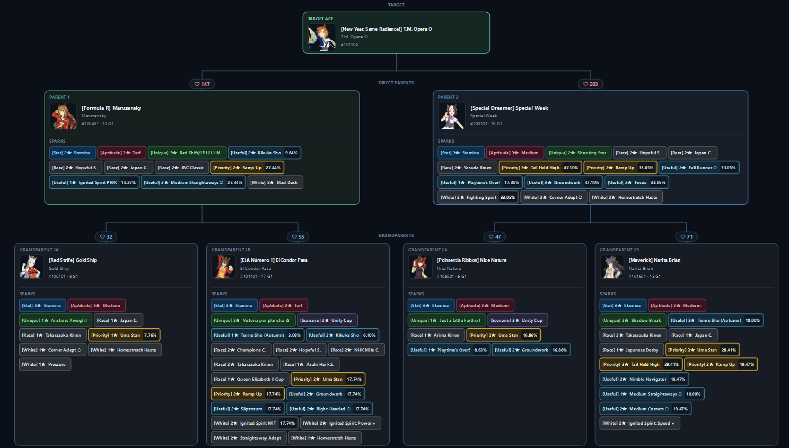
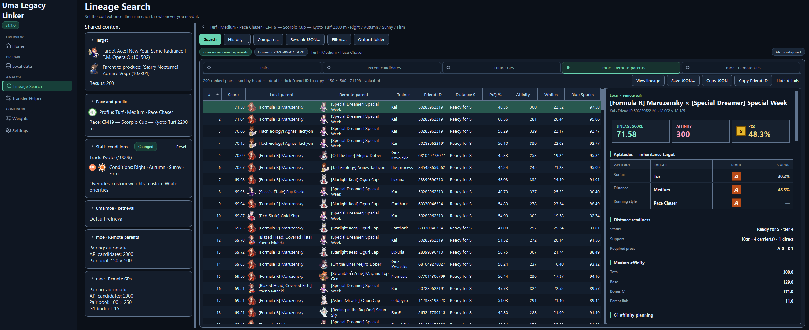
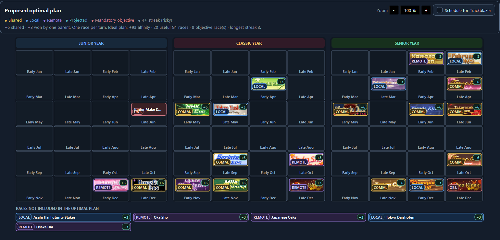
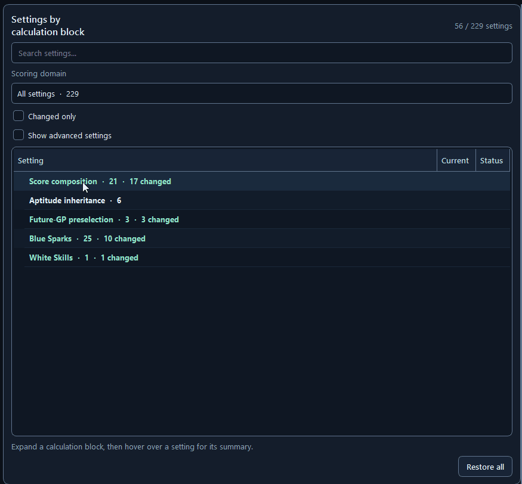

<div align="center">


# Uma Legacy Linker

**Compare inheritance lineages for Umamusume: Pretty Derby using your veterans and uma.moe.**

[](https://github.com/haunteds-house/UmaLegacyLinker/releases)
[](https://github.com/haunteds-house/UmaLegacyLinker/actions/workflows/release-windows.yml)
[](LICENSE)

Windows desktop application · English interface

This fork is the base for the collection and career planner. **My collection**
imports umadump ZIP/JSON exports and shows trainees, support cards and veterans
with pictures and names. **Career plans** uses illustrated choices for trainees,
parents and support decks, or starts from skills and aptitudes and searches the
collection for suitable setups. **Team Trials** compares recorded race results
and starts replacement plans with the runner choice open. **Calculators** budgets
skill points, awakening materials and Grand Concert songs inside the app.
**Lineage linker** keeps the original inheritance tools in the sidebar.
The native **Veterans** and **Lineage planner** views show ancestry, combined
sparks, compatibility and starting aptitudes, then carry exact owned parent
copies into a career plan. No website or browser engine is embedded.
See the [collection guide](docs/WORKBENCH.md) and [remaining goals](docs/ROADMAP.md).

Suggested setups include a **Practice estimate** tab. Compare your owned support
effects under an editable practice plan, see stat contributions and skill points,
and review similar completed careers. These are practice subtotals under saved
conditions; whole-career and race forecasts are still in development.

[Download](#quick-start) · [Features](#features) · [Documentation](#documentation)

</div>

Choose the Ace you want to train, the course and your running style. Uma Legacy Linker ranks parent pairs and future grandparents, with a breakdown of the Sparks, aptitude probabilities, affinity and G1 compatibility behind each result.

<p align="center">
  
</p>

## Quick start

1. Open the [latest release](https://github.com/haunteds-house/UmaLegacyLinker/releases/latest) and download `UmaLegacyLinkerQt-win64.zip`. Check the release notes and prerelease label for that version.
2. Extract the **whole ZIP** and run `UmaLegacyLinkerQt.exe`. Keep its runtime files together; Python is included.
3. Obtain your current game database, `master.mdb`, and export your veterans with [umadump](https://github.com/Werseter/umadump) or [UmaExtractor](https://github.com/xancia/UmaExtractor), following that tool's instructions.
4. From **Home**, choose **1 · Set up and import**. Choose `master.mdb` in **Setup**, click **Save setup**, then **Import my collection** to select your ZIP or JSON exports.
5. Browse and sort your characters in **My collection**, start a **Career plan**, or choose **Link collection for lineage** to prepare your veterans for the **Lineage linker**.

These steps support local inheritance ranking without an API key. **Open umadump** launches your existing unmodified executable. **Lineage linker** and **Link exported veterans** are always visible; the transfer and scoring editors are available through **Show advanced tools**. Prepare the inheritance search again after replacing the MDB or collection export.

This README describes the current source tree; published builds and prereleases are described by their own release notes.

### uma.moe access

To create a key for remote searches:

1. Sign in to [uma.moe](https://uma.moe/).
2. Open your [account settings](https://uma.moe/settings) and scroll to **API Keys** near the bottom.
3. Under **Create a new key**, enter a name such as `Uma Legacy Linker` and select **Create Key**.
4. Copy the key into **Settings → API key** in Uma Legacy Linker and save the settings.

The default API URL is `https://uma.moe/api`. **Remember key** stores it separately from the general configuration, encrypted with Windows DPAPI on Windows. Other platforms use a local file with restricted permissions, without encryption. `UMA_MOE_API_KEY` is also supported and takes precedence when the app starts.

Retrieval is capped at **2,000 candidates per search**. Saved responses can be imported for ranking without repeating the request. Check that a remote parent's Friend ID is still available in game before starting a career.

## Features

### Search and inspect lineages

| Search | Use |
| --- | --- |
| Final parent pairs | Compare two local parents and their four grandparents for the Ace |
| Individual parents | Evaluate a parent branch as one half of a lineage |
| Future grandparents | Find local material for producing a future parent |
| Remote parents | Pair local parents with uma.moe candidates |
| Remote GPs | Pair a local GP with remote candidates, with a local-only alternative |

Champion Meeting presets and generic Team Trials profiles fill the race context; conditions remain editable. Fix a parent or constrain the candidate pool when part of your lineage is already chosen.

Inspect factor sources, estimated inheritance probabilities and G1 schedules. Compare two candidates side by side, or compare the current result with its retained predecessor. Rankings and diagnostics are saved as JSON and CSV.

<p align="center">
  
</p>

The G1 planner shows Standard schedules with mandatory character objectives and a Trackblazer variant without them. Generic GP-pair searches use a fast estimate followed by exact shortlist rescoring; this can miss a pair outside the shortlist. An exhaustive ranking mode is available. See the [scoring model](docs/SCORING.md#104-generic-gp-screening-and-exact-reranking) for scope and limits.

<p align="center">
  
</p>

### Adjust the scoring

The **Weights** page edits structural scoring weights and White Skill priorities over bundled defaults. Change the emphasis on aptitude targets, Blue Sparks, skills, affinity or G1 value to suit your build. The editor previews each weight's effective share within its group.

Save a profile and rerun the search to apply it. Effective profiles are written as `active_parent_scoring.json` and `active_skill_priorities.json` in the output directory. Bundled priorities are a starting point; they do not guarantee a competitive build or an inheritance outcome.

<p align="center">
  
</p>

### Transfer Helper (work in progress)

> [!WARNING]
> Review the evidence before transferring a veteran in game. Transfer Helper is a work in progress: its verdicts depend on the evaluated contexts and configured thresholds. It never transfers veterans or modifies the source export.

The helper selects a collection of same-costume copies that covers useful parent and GP roles while preserving protected inheritance assets.

| Verdict | Meaning |
| --- | --- |
| **Protected** | Preserved because of an in-game lock or memo |
| **Keep** | Required by the selected collection portfolio |
| **Recommended transfer** | Covered by retained copies collectively, without a verified strict individual replacement |
| **Strictly safe transfer** | One retained same-costume, same-Unique replacement passes the individual checks; exhaustive mode only |
| **Review** | Portfolio coverage could not be established |

## Data and network use

The MDB resolves game IDs, factors and race data. Exporters are separate tools that access the running game to produce the collection file; they have their own requirements. Linking and scoring read the supplied files locally and leave the originals unchanged.

Remote searches contact uma.moe. The UI can also download optional GameTora artwork, cached locally and controllable from the lineage inspector. Local scoring does not require those images or a network connection.

## Documentation

| Document | Contents |
| --- | --- |
| [User guide](docs/USER_GUIDE.md) | Setup, workflows, result states and troubleshooting |
| [Collection and career plans](docs/WORKBENCH.md) | Requirement search, sorting, replacement plans and internal calculators |
| [Remaining goals](docs/ROADMAP.md) | Implemented scope, limits and next development steps |
| [Practice model](docs/TRAINING_MODEL.md) | Support effects, formula checks, comparison assumptions and limits |
| [Scoring](docs/SCORING.md) | Formulas, probabilities and model limits |
| [Scoring configuration](docs/SCORING_CONFIGURATION.md) | Weights, overrides and merge rules |
| [Architecture](docs/ARCHITECTURE.md) | Modules, processes, execution settings and persistence |
| [Releasing](docs/RELEASING.md) | Tests, Windows packaging and checksum verification |
| [Third-party components](docs/THIRD_PARTY.md) | Data sources, external tools and licence notices |
| [Changelog](CHANGELOG.md) | Version history |

<details>
<summary>Run from source or use the CLI</summary>

Python 3.12 is used for the Windows build. From a checkout with that interpreter:

```powershell
git clone https://github.com/haunteds-house/UmaLegacyLinker.git
cd UmaLegacyLinker
py -m pip install -r requirements-qt.txt
py qt_app.py
```

`run.bat` starts the same interface. Headless linking, catalogue generation, local ranking and Transfer Helper are available through:

```powershell
py cli.py --help
```

The backend lives in `uma_legacy_linker/`, the desktop UI in `ui_qt/`, and bundled profiles and icons in `resources/`. Build instructions and validation commands are in [Releasing](docs/RELEASING.md).

</details>

For an unexpected ranking or crash, [open an issue](https://github.com/haunteds-house/UmaLegacyLinker/issues/new) with the application version, selected workflow, race context and relevant diagnostics. Remove API keys and personal identifiers before sharing files.

## Credits

Thanks to [uma.moe](https://uma.moe/) for remote parent search, [umadump](https://github.com/Werseter/umadump) and [UmaExtractor](https://github.com/xancia/UmaExtractor) for collection exports, and [GameTora](https://gametora.com/umamusume) for reference material and optional artwork. Upstream tools and community inheritance references are listed in [Third-party components](docs/THIRD_PARTY.md).

Independent community project, not affiliated with or endorsed by Cygames. Umamusume: Pretty Derby and related assets belong to their respective rights holders. Game databases, collection exports, remote datasets and extractor executables are not bundled. Documentation recordings may show game artwork; the application does not bundle the downloaded artwork cache.

## License

Uma Legacy Linker is free software licensed under the [GNU General Public License, version 3](LICENSE) (`GPL-3.0-only`). You may use, modify and redistribute it under those terms. It is provided without warranty.

Third-party components retain their own licences; game artwork and other third-party material are not relicensed by this project. See [Third-party components](docs/THIRD_PARTY.md).
